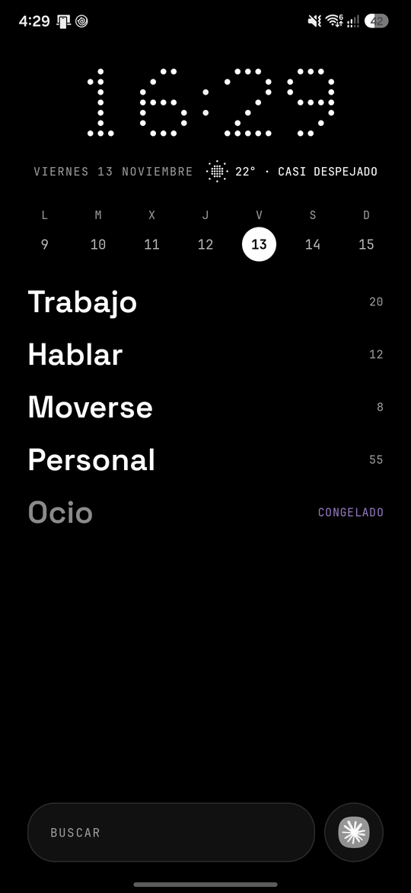
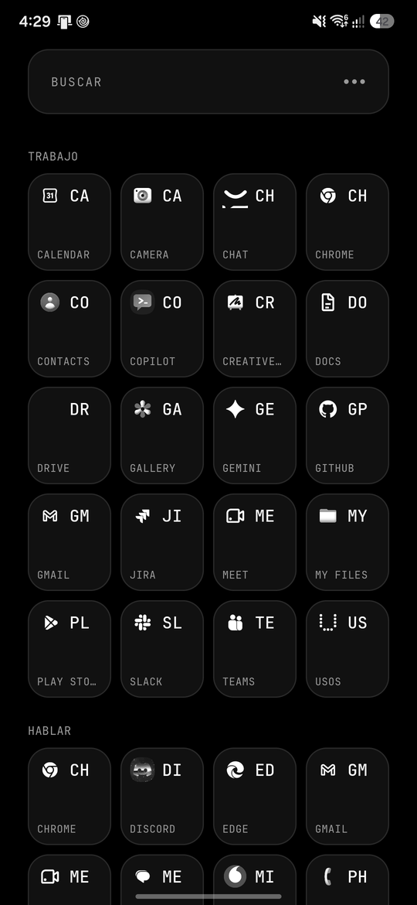
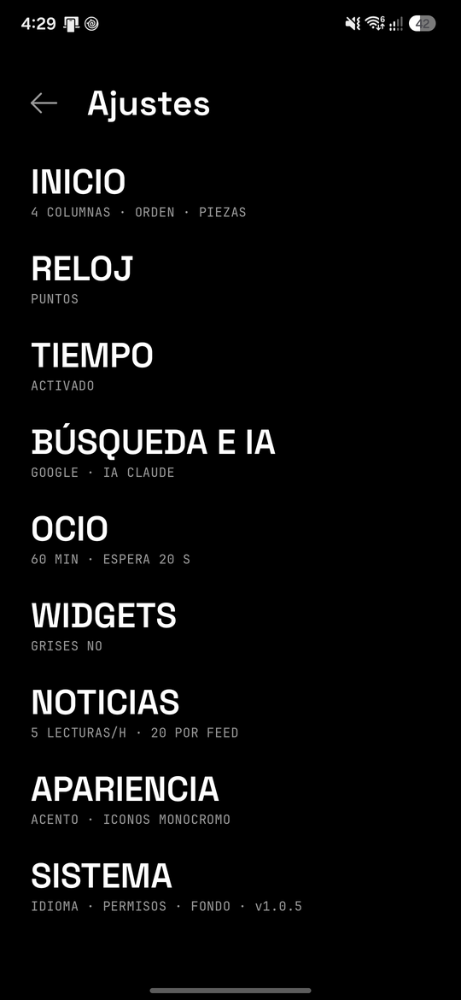

# Usos

Minimalist, anti-procrastination Android launcher. Español: [más abajo](#usos-en-español).

  
  

## What it is

A single black screen with a dot-matrix clock, a week strip and a search bar. No dock, no wallpaper.

- **Sections by use:** apps are sorted by what you use them for (Work, Talk, Move, Personal, Leisure, Other) and unfold into a configurable **tile mosaic**.
- **Frozen Leisure:** leisure apps stay frozen until you ask for time. A **daily budget** of minutes and a **wait** before they open.
- **Universal search + AI button:** apps, URLs, web search with optional suggestions, and a quick button to ask your favourite AI assistant.
- **Widgets** page: Android widgets in the same tile grid.
- **News by reads:** RSS/Atom feeds where opening an unread article spends one "read" from a bucket that refills over time.
- Optional weather, calendar and notification indicator (reads only which app has notifications, never their content), per-app usage, black wallpaper, English and Spanish.

## Install

1. Download `usos-X.Y.Z.apk` from [Releases](https://github.com/27Salex/usos-launcher/releases).
2. Allow installing from unknown sources for your browser or file manager and open the APK.
3. Press Home and choose **Usos** as the home app.
4. Grant what the first-run guide asks for: **usage access**, the **accessibility service** (blocks frozen apps; on Android 13+ you may need *Allow restricted settings* in the app info first), and battery settings so the service is not killed.

## Updates

Usos checks the latest GitHub release at most once every 24 h when opened (switch off in Settings > SYSTEM, or press **CHECK FOR UPDATES**). It downloads the APK, verifies it has the same package name and signing certificate as the installed app and a higher version code, and installs it through the system installer. Updating never resets your configuration.

## Privacy

No analytics, no accounts, no tracking. The network is used only for: your news feeds, optional search suggestions, optional weather (Open-Meteo), and the update check against GitHub.

## Build

```
./gradlew test assembleRelease
```

Signing uses your own key, read from `~/.android/usos/keystore.properties` (`storeFile`, `storePassword`, `keyAlias`, `keyPassword`). Without that file the release build still succeeds and produces an **unsigned** APK (`app/build/outputs/apk/release/app-release-unsigned.apk`) that you must sign yourself. Never commit keys. Note that updates only work between APKs signed with the same key.

## Translate

See [TRANSLATING.md](TRANSLATING.md).

## License

[PolyForm Noncommercial 1.0.0](LICENSE): free for personal and non-commercial use; no commercial use. Fonts: see [THIRD_PARTY_NOTICES.md](THIRD_PARTY_NOTICES.md).

---

# Usos en español

Launcher Android minimalista contra la procrastinación: una pantalla negra con reloj de puntos, secciones por uso que se despliegan en un **mosaico**, **Ocio congelado** (presupuesto diario de minutos y espera antes de abrir), **búsqueda universal** con botón de IA, **widgets** y **noticias por lecturas** (abrir un artículo no leído gasta una lectura que se repone con el tiempo).

**Instalación:** descarga `usos-X.Y.Z.apk` de [Releases](https://github.com/27Salex/usos-launcher/releases), permite instalar apps desconocidas, ábrelo, elige Usos como app de inicio y concede lo que pide el primer arranque: acceso de uso, servicio de accesibilidad (en Android 13+ puede hacer falta *Permitir ajustes restringidos* en la info de la app) y batería sin restricciones.

**Actualizaciones:** al abrir el launcher (máx. una vez cada 24 h; desactivable en Ajustes > SISTEMA, o «BUSCAR ACTUALIZACIONES») consulta la última release de GitHub, descarga el APK, comprueba paquete, firma y versión, e instala. Tu configuración se conserva.

**Privacidad:** sin analíticas. Red solo para tus feeds, sugerencias opcionales, tiempo opcional y la comprobación de actualizaciones.

**Compilar:** `./gradlew test assembleRelease`; firma con tu propia clave en `~/.android/usos/keystore.properties`. Sin ella sale un APK sin firmar. **Traducir:** [TRANSLATING.md](TRANSLATING.md). **Licencia:** PolyForm Noncommercial 1.0.0 (uso personal y no comercial libre, sin uso comercial).
